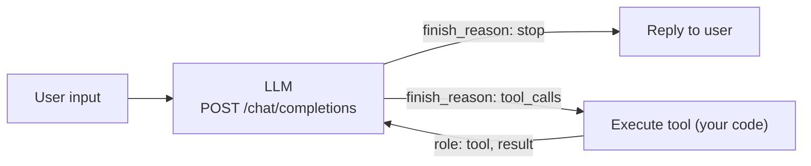

# MyAgent — The First Agent Architecture You'll Ever Build

> 6 lessons · pure Python stdlib · zero dependencies · ~500 lines of code
> From raw HTTP to a production-grade agent skeleton — built by hand, not imported.

**[English](README.md)** | [简体中文](README_zh.md) · 国内镜像 / China mirror: [gitee.com/xyzyzhr/MyAgent](https://gitee.com/xyzyzhr/MyAgent)

[](LICENSE)
[](https://www.python.org)
[]()


*Real output after finishing the course: parallel tool calls (calculator + clock) in the first half; in the second half the calculator fails with `ZeroDivisionError`, and the model reads that error and explains in its own words why 17÷0 is undefined. That feedback loop is the entire magic.*

## Why Not Just Use a Framework?

LangChain and friends get an agent running in 10 minutes, but you don't know what's happening under any of their APIs. This course hand-writes the agent **trinity — loop + tool registry + context management** using nothing but the standard library:



| Lesson | Topic | Hands-on file | One-liner |
|---|---|---|---|
| 1 | The bare form of an LLM | `hello.py` | LLM = a stateless HTTP service |
| 2 | Conversation is context | `chat.py` | Memory is an illusion the client constructs |
| 3 | First tool call | `agent_v1.py` | The model only "requests"; your code "executes" |
| 4 | The agent main loop | `agent.py` | Agent = while loop + stop condition |
| 5 | Memory & context management | `agent.py` + `test_lesson5.py` | Observe / trim / persist |
| 6 | Hardening for production | `llm_client.py` etc. | Retry / streaming / logging — the truth about frameworks |

**After the course you can**:

- Walk through, step by step, the full journey of "the model calling one tool"
- Read any agent framework's source code (LangChain opens up to the same skeleton)
- Hand-roll a minimal agent in 30 minutes, in any environment

## Quick Start

Requires Python 3.9+ (3.11+ recommended). No third-party dependencies — nothing to `pip install`.

1. Clone / download this repo
2. Create your config:
   ```bash
   # Windows (cmd)
   copy config.example.json config.json
   # macOS / Linux
   cp config.example.json config.json
   ```
   then edit `config.json` with your `base_url` / `model` / `auth`
3. (Optional) Virtualenv: `python -m venv .venv` and activate it
4. Open the Lesson 1 skeleton: `python hello.py` (after filling its 3 TODOs)
5. Follow the `lessons/` directory in order

## Any OpenAI-Compatible Backend

Works with any OpenAI-compatible `chat/completions` endpoint:

| Provider | base_url example | model example |
|---|---|---|
| OpenAI | `https://api.openai.com/v1` | `gpt-4o-mini` |
| Gcable | `https://api.playground.ai.gcable.cc/v1` | `Gcable-Plus-Thinking` |
| DeepSeek | `https://api.deepseek.com/v1` | `deepseek-chat` |
| Moonshot | `https://api.moonshot.cn/v1` | `moonshot-v1-8k` |
| Qwen DashScope | `https://dashscope.aliyuncs.com/compatible-mode/v1` | `qwen-plus` |
| Local Ollama | `http://localhost:11434/v1` | `qwen2.5:7b-instruct` |

Note: **the model must support function calling (tools)** — without it, Lesson 3+ won't pass.

## ⚠️ Security

- `config.json` holds your API key. It's in `.gitignore` — **never commit it**
- Anyone with your `Bearer` key can spend your quota — don't send it to anyone, don't paste it anywhere public
- Model-generated tool arguments are **untrusted input** — that's why the course calculator uses an AST whitelist and never `eval`s

## Project Structure

```
MyAgent/
├── README.md               this file (English)
├── README_zh.md            Chinese README
├── LICENSE                 MIT license
├── config.example.json     config template (copy to config.json, then fill in)
├── .gitignore              config.json / history.json never enter the repo
├── assets/demo.gif         demo GIF (a real run)
├── lessons/                course docs (each: theory / tasks / acceptance / questions / pitfalls)
│   ├── 01-llm-basics.md
│   ├── 02-context.md
│   ├── 03-tool-calling.md
│   ├── 04-agent-loop.md
│   ├── 05-memory-context.md
│   ├── 06-engineering.md
│   └── answers.md          reference answers (answer first, peek later)
├── hello.py                Lesson 1 skeleton
├── chat.py                 Lesson 2 skeleton
├── agent_v1.py             Lesson 3 skeleton (kept as your "Lesson 3 homework")
├── agent.py                Lesson 4/5/6 skeleton (main loop + context + hardening)
├── llm_client.py           protocol layer skeleton (chat / retry / stream)
├── test_lesson5.py         Lesson 5 acceptance tests (9 checks)
└── test_lesson6.py         Lesson 6 acceptance tests (4 checks, 2 real API calls)
```

## The Teaching Skill: Let an AI Agent Teach You

`teaching-skill/` contains a standard skill file (`SKILL.md`). Hand it to your AI agent
(Hermes / Claude Code / Cursor / any agent that can read skill files) and it will guide
you through all 6 lessons as a "course teacher": one lesson at a time, hints instead of
answers when you're stuck, and the next lesson only unlocks once your tests are green.

How to use:

- **Hermes**: copy the `teaching-skill/` directory into your skills folder, then tell the agent "walk me through the MyAgent course"
- **Claude Code**: drop it into `.claude/skills/`, or paste the whole SKILL.md into the chat
- **Other agents**: put the SKILL.md content into the system prompt / context

## Study Tips

- One lesson per day is the right pace; each lesson = 10 min theory + 30~60 min hands-on + comprehension questions
- When stuck: read the error first, then ask the agent for a **hint**, not "write it for me"
- Comprehension answers live in `lessons/answers.md` — answer yourself first, peek later
- Each lesson's "common pitfalls" were written from actually hitting them — read them carefully

## License

MIT (see LICENSE)
