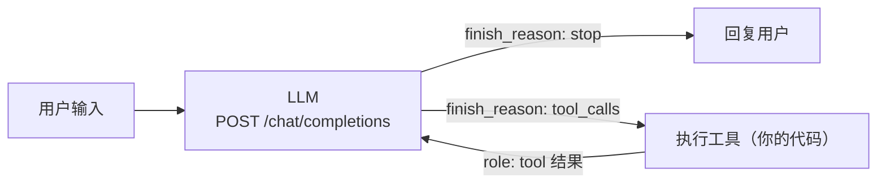

# MyAgent —— 你学习的第一个 Agent 架构

> 6 节课 · 纯 Python 标准库 · 零依赖 · 约 500 行代码
> 从裸 HTTP 到生产级 Agent 骨架，亲手写出来，而不是调出来。

**[English](README.md)** | 简体中文 · 国际镜像 / International mirror: [github.com/zyxyzhr/my-agent](https://github.com/zyxyzhr/my-agent)

[](LICENSE)
[](https://www.python.org)
[]()


*课程学完后的真实运行：前半段是并行工具调用（计算器 + 时钟）；后半段计算器报 `ZeroDivisionError`，模型读到错误后用自己的话解释了 17÷0 为什么没有定义——这个反馈回路就是全部的魔法。*

## 为什么不直接用框架？

LangChain 等框架 10 分钟就能跑起一个 Agent，但你不清楚任何一个 API 底下在发生什么。
本课程用纯标准库手写 Agent 的**三件套——循环 + 工具注册 + 上下文管理**：



| 课 | 主题 | 动手文件 | 核心一句话 |
|---|---|---|---|
| 1 | LLM 的裸形态 | `hello.py` | LLM = 无状态的 HTTP 服务 |
| 2 | 对话就是上下文 | `chat.py` | 记忆是客户端构造的错觉 |
| 3 | 第一次工具调用 | `agent_v1.py` | 模型只"申请"，代码才"执行" |
| 4 | Agent 主循环 | `agent.py` | Agent = while 循环 + 停止条件 |
| 5 | 记忆与上下文管理 | `agent.py` + `test_lesson5.py` | 观察 / 截断 / 持久化 |
| 6 | 工程化加固 | `llm_client.py` 等 | 重试 / 流式 / 日志，框架的真相 |

**学完你能**：

- 逐条讲清楚"模型调用一个工具"的完整旅程
- 读懂任何 Agent 框架的源码（LangChain 扒开就是同一个骨架）
- 在任何环境里 30 分钟手搓一个最小 Agent

## 快速开始

要求 Python 3.9+（建议 3.11+），无第三方依赖，不需要 pip 装任何东西。

1. 克隆 / 下载本项目
2. 创建配置：
   ```bash
   # Windows (cmd)
   copy config.example.json config.json
   # macOS / Linux
   cp config.example.json config.json
   ```
   然后编辑 `config.json`，填入你的 `base_url` / `model` / `auth`
3. （可选）虚拟环境：`python -m venv .venv` 并激活
4. 打开第 1 课骨架：`python hello.py`（填完 3 个 TODO 后运行）
5. 按 `lessons/` 目录顺序开课

## 后端选择（任意 OpenAI 兼容 chat/completions 端点）

| 提供商 | base_url 示例 | model 示例 |
|---|---|---|
| OpenAI | `https://api.openai.com/v1` | `gpt-4o-mini` |
| Gcable | `https://api.playground.ai.gcable.cc/v1` | `Gcable-Plus-Thinking` |
| DeepSeek | `https://api.deepseek.com/v1` | `deepseek-chat` |
| Moonshot | `https://api.moonshot.cn/v1` | `moonshot-v1-8k` |
| 通义千问 DashScope | `https://dashscope.aliyuncs.com/compatible-mode/v1` | `qwen-plus` |
| 本地 Ollama | `http://localhost:11434/v1` | `qwen2.5:7b-instruct` |

注意：**模型必须支持 function calling（tools）**，第 3 课起用不到它就过不了。

## ⚠️ 安全

- `config.json` 含你的 API 密钥，已在 `.gitignore` 中，**永远不要提交它**
- `Bearer` 密钥谁拿到谁就能花你的额度——不要发给任何人、不要贴到任何公开场合
- 模型生成的工具参数是"不可信输入"——这就是本课计算器用 AST 白名单、绝不 `eval` 的原因

## 项目结构

```
MyAgent/
├── README.md               英文 README
├── README_zh.md            本文件（中文）
├── LICENSE                 MIT 开源协议
├── config.example.json     配置模板（复制为 config.json 后填写）
├── .gitignore              config.json / history.json 永不入库
├── assets/demo.gif         演示 GIF（真实运行）
├── lessons/                课程文档（每课：理论/任务/验收/理解题/常见坑）
│   ├── 01-llm-basics.md
│   ├── 02-context.md
│   ├── 03-tool-calling.md
│   ├── 04-agent-loop.md
│   ├── 05-memory-context.md
│   ├── 06-engineering.md
│   └── answers.md          理解题参考答案（先答再看）
├── hello.py                第 1 课骨架
├── chat.py                 第 2 课骨架
├── agent_v1.py             第 3 课骨架（保留为你的"第 3 课作业"）
├── agent.py                第 4/5/6 课骨架（主循环 + 上下文管理 + 工程化）
├── llm_client.py           协议层骨架（chat / retry / stream）
├── test_lesson5.py         第 5 课验收测试（9 项）
└── test_lesson6.py         第 6 课验收测试（4 项，含 2 次真实 API 调用）
```

## 教学 Skill：让 AI 智能体教你学

`teaching-skill/` 目录里是一个标准 skill 文件（`SKILL.md`）。把它交给你的 AI 智能体
（Hermes / Claude Code / Cursor / 任何能读 skill 文件的 agent），它会以"课程老师"的身份
引导你学完 6 课：一次一课、卡住只给提示不写答案、测试全绿才放行下一课。

用法：

- **Hermes**：把 `teaching-skill/` 目录复制到你的 skills 目录，对 agent 说"带我学 MyAgent 课程"
- **Claude Code**：放入 `.claude/skills/`，或直接把 SKILL.md 全文贴进对话
- **其他 agent**：把 SKILL.md 全文放进系统提示词 / 上下文即可

## 学习建议

- 一天一课，节奏刚好；每课 = 理论 10 分钟 + 动手 30~60 分钟 + 理解题
- 卡住时先读报错，再向智能体要"提示"，而不是"帮我写"
- 理解题答案在 `lessons/answers.md`——先自己答，再看答案
- 每课的"常见坑"是真实踩过才写进去的，重点看

## License

MIT（见 LICENSE）
